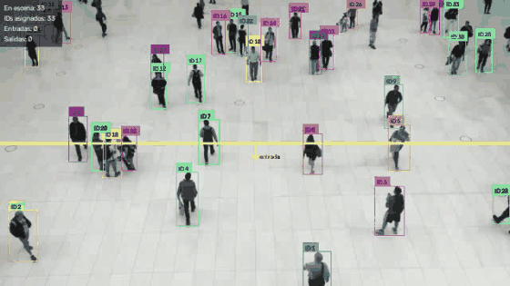

# Seguimiento de personas con ID


Programa en Python que analiza un vídeo, **detecta a cada persona que aparece, le asigna un identificador fijo** (ID 1, ID 2, ID 3...) que se mantiene mientras la persona sigue en escena, y **cuenta cuántas personas pasan** y cuántas cruzan una línea virtual en cada sentido.



## Qué hace

- **Detección** de personas en cada frame con [YOLO11](https://docs.ultralytics.com/models/yolo11/) (preentrenado en COCO, clase `person`).
- **Seguimiento multi-objeto** con [ByteTrack](https://arxiv.org/abs/2110.06864) (o BoT-SORT): asocia las detecciones de un frame con las del anterior para que cada persona conserve su ID.
- **IDs legibles**: el tracker numera internamente con huecos; aquí se renumeran en orden de aparición, así que la primera persona es la 1, la segunda la 2, etc.
- **Línea de conteo** configurable: cuenta *entradas* y *salidas* según el sentido en que se cruza. Cada ID cuenta como mucho una vez por sentido, así que alguien parado encima de la línea no infla el contador.
- **Filtro de IDs fugaces**: un ID que solo aparece unos pocos frames (falso positivo o identidad partida) no cuenta como persona en el resumen.
- **Salidas**: vídeo anotado (cajas, ID, trayectoria y marcador), CSV con una fila por persona, resumen en JSON y, opcionalmente, resultados en formato MOTChallenge para evaluar el tracker.

## Cómo funciona

```
 vídeo ──► YOLO11 (personas) ──► ByteTrack (asocia entre frames) ──► IDs 1, 2, 3...
                                                                        │
                       ┌────────────────────────────────────────────────┤
                       ▼                                                ▼
         LineCounter (¿el punto de los pies                 Report (primer/último frame,
         ha cruzado la línea? ¿en qué sentido?)             tiempo en escena, confianza)
                       │                                                │
                       └──────────────► Visualizer ◄────────────────────┘
                                            │
                     video_anotado.mp4 · personas.csv · resumen.json
```

Para saber si alguien cruza la línea se toma el punto medio de la parte inferior de su caja (los pies) y se comprueba si el segmento entre su posición anterior y la actual corta el segmento de la línea. El signo del producto vectorial dice en qué sentido lo ha cruzado. Esta lógica está en [`seguimiento/line_counter.py`](seguimiento/line_counter.py) y no depende de YOLO, por eso tiene sus propios tests.

## Instalación

```bash
git clone https://github.com/Ptraverso17/seguimiento-personas-id.git
cd seguimiento-personas-id
python -m venv .venv
source .venv/bin/activate        # En Windows: .venv\Scripts\activate
pip install -r requirements.txt
```

Los pesos de YOLO (`yolo11n.pt`, unos 6 MB) se descargan solos la primera vez. Funciona en CPU; con una GPU NVIDIA va mucho más rápido (`--device 0`).

## Uso

```bash
# Lo básico: línea horizontal a media altura, resultados en resultados/
python -m seguimiento --source mi_video.mp4

# Ver el vídeo mientras se procesa
python -m seguimiento --source mi_video.mp4 --show

# Línea vertical en el centro (valores 0-1 = fracciones del ancho y alto)
python -m seguimiento --source mi_video.mp4 --line 0.5,0,0.5,1

# Línea en píxeles, modelo más preciso y BoT-SORT
python -m seguimiento --source mi_video.mp4 --line 100,400,1200,450 --model yolo11s.pt --tracker botsort

# Webcam
python -m seguimiento --source 0 --show

# Secuencia de MOT17 (carpeta de imágenes) y resultados en formato MOT
python -m seguimiento --source datos/MOT17/train/MOT17-04-FRCNN --mot --no-video
```

| Opción | Por defecto | Qué hace |
|---|---|---|
| `--source` | (obligatoria) | Vídeo, carpeta de imágenes o `0` para la webcam |
| `--output` | `resultados` | Carpeta donde se guardan los resultados |
| `--model` | `yolo11n.pt` | Pesos de YOLO: `n` rápido, `s`/`m`/`l` más precisos |
| `--tracker` | `bytetrack` | `bytetrack` o `botsort` |
| `--line` | `0,0.5,1,0.5` | Línea de conteo `x1,y1,x2,y2` (píxeles o fracciones 0-1); `none` la desactiva |
| `--anchor` | `feet` | Punto que tiene que cruzar la línea: `feet` (pies) o `center` |
| `--imgsz` | `960` | Resolución de entrada del modelo; súbela si la gente sale muy pequeña |
| `--conf` | `0.3` | Confianza mínima de detección |
| `--min-frames` | `5` | Frames que debe durar un ID para contar como persona en el resumen |
| `--show` / `--no-video` / `--no-trails` / `--mot` | | Ventana en vivo / no guardar vídeo / sin trayectorias / exportar formato MOT |

La flecha amarilla del vídeo marca el sentido que cuenta como **entrada**. Si quieres el contrario, intercambia los dos puntos de la línea.

### Resultados que genera

```
resultados/
├── video_anotado.mp4      # el vídeo con cajas, IDs, trayectorias y marcador
├── personas.csv           # una fila por ID
├── resumen.json           # totales del vídeo
└── mot_resultados.txt     # (con --mot) formato MOTChallenge
```

`personas.csv`:

| id | primer_frame | ultimo_frame | frames_visible | segundos_en_escena | confianza_media | cruces |
|---|---|---|---|---|---|---|
| 1 | 0 | 61 | 62 | 2.07 | 0.839 | |
| 8 | 0 | 61 | 62 | 2.07 | 0.700 | salida\|entrada |
| 9 | 0 | 61 | 62 | 2.07 | 0.737 | entrada |

## Ejemplo de resultado

Con el vídeo de la demo (vista cenital de un vestíbulo, 62 frames, 640×360) y la configuración por defecto, en CPU:

| Métrica | Valor |
|---|---|
| Personas únicas (IDs con ≥ 5 frames) | 40 |
| Máximo de personas a la vez | 36 |
| Cruces de la línea (entrada / salida) | 2 / 2 |
| Velocidad en CPU | ~12 FPS |

Comparativa rápida en el mismo vídeo:

| Modelo | `imgsz` | Máx. personas detectadas a la vez | FPS (CPU) |
|---|---|---|---|
| yolo11n | 640 | 20 | 16.7 |
| yolo11s | 640 | 24 | 10.3 |
| **yolo11n** | **960** | **36** | **11.9** |
| yolo11s | 960 | 27 | 6.0 |

En esta escena la gente aparece muy pequeña, así que subir la resolución de entrada ayuda más que usar un modelo más grande. Por eso `--imgsz 960` es el valor por defecto.

## Dónde conseguir vídeos y datos

| Fuente | Qué tiene | Para qué sirve aquí |
|---|---|---|
| [MOT17](https://motchallenge.net/data/MOT17/) | 14 secuencias de peatones con anotaciones (caja + ID) por frame | Evaluar el tracker con métricas estándar (HOTA, MOTA, IDF1) |
| [MOT20](https://motchallenge.net/data/MOT20/) | Escenas muy densas (hasta ~250 personas por frame) | Poner a prueba el sistema con multitudes |
| [Pexels Videos](https://www.pexels.com/search/videos/people%20walking/) | Vídeos de stock gratuitos ("people walking", "crowd", "street") | Demos y pruebas; licencia libre para uso personal y comercial |
| [Pixabay Videos](https://pixabay.com/videos/search/people%20walking/) | Similar a Pexels | Más vídeos de prueba |
| [Intel IoT sample videos](https://github.com/intel-iot-devkit/sample-videos) | Vídeos cortos pensados para visión por computador (`people-detection.mp4`, `one-by-one-person-detection.mp4`...) | Pruebas rápidas con escenas sencillas (CC BY 4.0) |
| [CrowdHuman](https://www.crowdhuman.org/) | 15.000 imágenes de multitudes anotadas | Reentrenar o afinar el detector si fallara con oclusiones |

Los vídeos no se suben al repositorio (están en `.gitignore`). Descárgalos en una carpeta `datos/`.

## Evaluar el tracker con MOT17

1. Descarga MOT17 desde [motchallenge.net/data/MOT17](https://motchallenge.net/data/MOT17/) y descomprímelo en `datos/MOT17`.
2. Genera los resultados de una secuencia de entrenamiento:
   ```bash
   python -m seguimiento --source datos/MOT17/train/MOT17-04-FRCNN --mot --no-video --line none --min-frames 1 --output resultados/MOT17-04
   ```
3. Evalúa con [TrackEval](https://github.com/JonathonLuiten/TrackEval), copiando `mot_resultados.txt` como `MOT17-04-FRCNN.txt` en la carpeta de trackers que espera TrackEval:
   ```bash
   python TrackEval/scripts/run_mot_challenge.py --BENCHMARK MOT17 --SPLIT_TO_EVAL train \
       --TRACKERS_TO_EVAL seguimiento --SEQ_INFO MOT17-04-FRCNN
   ```

## Estructura del proyecto

```
seguimiento-personas-id/
├── seguimiento/
│   ├── main.py            # CLI y bucle principal
│   ├── tracker.py         # YOLO + ByteTrack, renumeración de IDs, lectura de vídeo/imágenes
│   ├── line_counter.py    # geometría del cruce de línea (sin dependencias)
│   ├── report.py          # estadísticas por persona y exportación CSV/JSON/MOT
│   └── visualizer.py      # cajas, IDs, trayectorias, línea y marcador
├── tests/                 # pytest: lógica de conteo e informes
├── assets/                # GIF y captura de la demo
└── .github/workflows/     # CI que ejecuta los tests en cada push
```

Para ejecutar los tests:

```bash
pip install -r requirements-dev.txt
pytest
```

## Limitaciones y siguientes pasos

- **Cambios de ID**: si una persona queda tapada mucho rato, al reaparecer puede recibir un ID nuevo. BoT-SORT con re-identificación por apariencia (`--tracker botsort`) lo reduce. Un siguiente paso sería añadir un modelo de Re-ID (como OSNet) para recuperar identidades tras oclusiones largas.
- **Multitudes muy densas**: las personas muy pequeñas o solapadas se escapan al detector. Subir `--imgsz` o usar un modelo más grande ayuda, al coste de velocidad.
- **Zonas además de líneas**: contar cuánta gente hay dentro de un polígono (una tienda, un paso de cebra) y cuánto tiempo pasa ahí.
- **Mapa de calor** de las trayectorias para ver por dónde pasa más gente.

## Licencia

[AGPL-3.0](LICENSE), la misma que [Ultralytics](https://github.com/ultralytics/ultralytics), de la que depende el proyecto. El vídeo de la demo es de los [recursos de ejemplo de Ultralytics](https://github.com/ultralytics/assets/releases).
